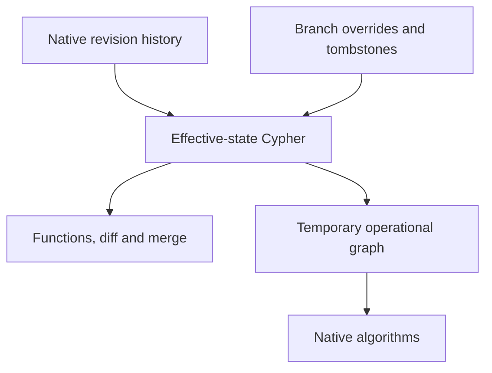

# Cheap creation, expensive projection: two native branch strategies

We added an explicit revision/overlay backend and compared it with the working native full-copy backend. The small experiment supports keeping both choices. Overlay creation is much cheaper, but whole-graph algorithms pay for materialization at read time. The default remains the copy backend.

## Recorded observations

Each strategy has its own identically seeded ontology. Five branches share one unchanged base revision; each changes the first object's score from 0 to -1. The test verifies all objects/edges, the full deterministic sum, a five-hop shortest path and one selected promotion. Every fixture is ingested through the HTTP API with validation and native version history. There is no direct database fixture shortcut.

Times are milliseconds. Each cell summarizes five observations by their median; the first/sibling columns distinguish whether copy creation also projects a base. Sibling medians use the four later branches. These samples describe this local run; they are not p95/p99 estimates or production capacity.

| Objects | Backend | First create | Sibling create | One-object edit | Effective read | Full-view function | Shortest path, including projection |
| ------: | ------- | -----------: | -------------: | --------------: | -------------: | -----------------: | ----------------------------------: |
|   1,000 | Copy    |      183.673 |         34.380 |         117.456 |         13.001 |             21.408 |                               7.650 |
|   1,000 | Overlay |        4.213 |          5.164 |          44.558 |         17.363 |             26.254 |                              71.415 |
|   5,000 | Copy    |      460.706 |        104.062 |         267.339 |         42.661 |             66.729 |                              10.458 |
|   5,000 | Overlay |        6.248 |          6.345 |         182.902 |         61.590 |             83.261 |                             284.868 |

At 5,000 objects, overlay sibling creation was about 16× faster. The one-record edit improved by about 32%, not by the creation ratio: it still reads and validates the full effective graph. Effective reads/functions were slower. The shortest-path request was about 27× slower because the overlay backend projects a temporary operational graph before running the native algorithm. The five-hop algorithm itself did not become intrinsically more expensive; its input preparation did.

First-copy creation includes base projection plus an independent `GRAPH.COPY`. Siblings reuse the base but still copy it. Copy edits build and publish another full candidate. Overlay creation writes only branch metadata; edits publish only changed native deltas and the new branch version in one query. Both paths remain coordinated by one API writer.

One promotion and the full cleanup phase are recorded separately in each raw file. A single promotion observation cannot establish a latency distribution. The experiment does not benchmark multiple changed-record fractions, concurrent clients or branch trees.

## Where the work moved



The effective read applies object and relationship visibility at the base revision, excludes identities shadowed by native markers and unions the surviving overrides. It does not replay a whole JSON snapshot/overlay in TypeScript. New/updated branch edges are actual `BRANCH_LINK` relationships. The single changed object uses one native `BranchObject` record regardless of base size; no base or working graph key is allocated by overlay creation.

Whole-graph procedures need an operational topology containing the effective business entities and edges. Today we materialize that topology for each overlay algorithm request, then delete it. Copy branches already have that graph. Caching a projection would need version-aware invalidation and recovery; we have not silently introduced such a cache to make this result look better.

Branches pin their native base revision for vacuum. They do not expire when an agent goes idle. Promotion still uses selected property-level three-way merge with an expected live revision. Historical _live_ reads use native validity intervals; old editable branch versions are not retained for time travel. A branch's version counter guards edits, while saved function evidence preserves an evaluated read set. This is not distributed MVCC or serializable read-set validation.

## Correctness and recovery

Nine overlay integration tests cover native overrides/tombstones/edges, inherited values after live writes, sibling isolation, mixed-backend copy-base reclamation, selected promotion/conflicts, pinned retention, cross-instance reopen, portable backup/restore, obsolete generations, invalid dangling-edge edits, racing edits and uncertain acknowledgments. A deliberate nested property in a native write plan produces a real engine runtime error; the previous deltas and branch version remain intact. That test exercises rollback rather than merely rejecting invalid API input before a query.

Logical backups materialize the base and portable deltas. Restore uses independent copy branches so it does not depend on an old generation. Unreferenced overlay records are collected on startup/discard. Algorithms/explanations remove their temporary projections; orphan collection handles interrupted cleanup. The GPU planner can reopen, calculate and explain an overlay created through the SDK. Compose CI now persists and restarts both branch backends.

## Reproduction and raw evidence

```sh
# Reachable disposable FalkorDB; this command starts its own local HTTP API.
pnpm benchmark:branches

BRANCH_SIZES=1000,5000 BRANCH_TRIALS=5 \
  BRANCH_OUTPUT=artifacts/branches/repeat pnpm benchmark:branches
```

The script creates/removes its own graph namespace and native keys. `FALKORDB_HOST`, `FALKORDB_PORT` and `FALKORDB_PASSWORD` configure the database. This run used a local database in a separate process, with API and HTTP client in one Node process, persistence disabled, chain topology and no concurrent readers/writers. The run measured copy first at 1,000 objects and overlay first at 5,000; it is not randomized repeated load. Warmup/JIT, engine cache, shared host activity and changing cumulative graph size can affect small samples.

The [environment record](evidence/branch-strategies/environment.json) contains versions, cgroup limits and the implementation source tree. The raw [1k copy](evidence/branch-strategies/1000-copy.json), [1k overlay](evidence/branch-strategies/1000-overlay.json), [5k copy](evidence/branch-strategies/5000-copy.json) and [5k overlay](evidence/branch-strategies/5000-overlay.json) files retain every observation and answer-checked phase.

Native memory estimates are recorded without pretending to be exclusive storage bytes. Copy working-graph memory excludes its shared base. Main-graph memory includes other study ontologies, history, calculation read sets and metadata, so it cannot be treated as the overlay's per-branch cost. Disk/temp copy bytes, full temporal backup, large-graph scaling, a fair historical JSON-backend comparison and sustained mixed workloads remain in the TODO. Two measured sizes do not prove asymptotically constant-time creation.
