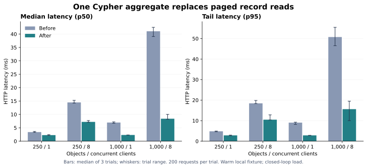

# Moving an aggregate to the graph

Our reusable API already stored typed properties in FalkorDB. Its aggregate endpoint still paged matching records into TypeScript, decoded them, and calculated the result there. That made a small result depend on several queries and transferred every matching record. It also meant concurrent changes could occur between pages.

We replaced that loop with one native Cypher aggregate. The filter validation and public result shape stay the same. Optional numeric properties are skipped; an empty numeric input returns `null`, while an empty count returns zero. One query now observes the records for the calculation together. This does not turn other multi-call application work into a transaction.

## Observed results



These are **local synthetic fixture measurements**, not a FalkorDB comparison or a capacity claim. Each cell below is the median of three trial statistics. Each trial completes 200 requests, after 20 warmups. p95 is computed within each trial and then summarized; it is not a pooled percentile. No trial has enough samples for a defensible p99, so the harness leaves that field null.

| Objects | Concurrent clients | Before p50 | After p50 | Before p95 | After p95 | Before requests/s | After requests/s |
| ------: | -----------------: | ---------: | --------: | ---------: | --------: | ----------------: | ---------------: |
|     250 |                  1 |   3.405 ms |  2.273 ms |   4.809 ms |  2.839 ms |               283 |              417 |
|     250 |                  8 |  14.479 ms |  7.209 ms |  18.456 ms | 10.488 ms |               539 |            1,015 |
|   1,000 |                  1 |   6.966 ms |  2.314 ms |   9.046 ms |  2.824 ms |               140 |              424 |
|   1,000 |                  8 |  41.053 ms |  8.387 ms |  50.756 ms | 15.621 ms |               190 |              847 |

At 1,000 objects and one client, aggregate p50 fell by about 67%. With eight clients, p50 fell by about 80%, while achieved throughput rose about 4.5×. These are changes to this API implementation on this workload. They are not the speedup of graph databases over another database.

Each fixture is a chain with consecutive numeric scores. The filter selects its upper half: 125 or 500 records. Both implementations must return the same count and sum. A filtered page request is also measured as a control. All recorded trials completed without errors. Raw data retains CPU, memory, each latency and each trial's elapsed time, rather than only the favorable summary.

## What the database actually did

The previous implementation requested pages of 100 records, with an extra record to determine whether another page exists. A 500-record result required five data queries, repeated schema checks, sorting/projection, transfer and decoding. Native aggregation returns one row. The improvement is from removing that work; no claim about a new graph algorithm is involved.

The capture includes both exact parameterized shapes, with concrete parameters prepended for `GRAPH.EXPLAIN` and read-only `GRAPH.PROFILE`:

```cypher
MATCH (o:Object {ontology:$ontology})
WHERE ($type='' OR o.type=$type)
  AND ($after='' OR o.id>$after)
  AND o.`p_score` >= $value0
RETURN count(o) AS count,
       count(o.`p_score`) AS numericCount,
       sum(o.`p_score`) AS value
```

The [1,000-object plans](evidence/aggregate-after/1000-plans.json) show `Node By Index Scan → Filter → Aggregate → Results`. The reference page has `Project → Sort → Limit` above the filter and returns up to 101 serialized records. Both shapes use the native numeric range index. Profile timings execute one warm query separately and should not be added to, or substituted for, the end-to-end HTTP measurements.

The equivalence integration test covers more than one old page of records, optional numeric values, negatives/fractions, empty results, all five aggregate operations, string/boolean/numeric filters, type and ontology isolation, and invalid inputs. Existing SDK/platform tests cover the route and its contract.

## Branching is still expensive

The same harness records full native branch creation and a one-record edit. It keeps the first branch alive so sibling creation really reuses the stored base, then discards all five branches. The first measurement includes base projection plus copy; sibling measurements include a full copy. Every edit currently copies its candidate graph before pointer publication.

See the [raw branch timings](evidence/aggregate-after/1000-branches.json). Five samples are descriptive observations, not a tail-latency distribution. They expose a remaining cost worth tackling: a one-record edit still pays for an independent full graph. We have not yet measured or shipped the cheaper native revision/overlay alternative, so this report does not imply constant-time branching.

## Reproduction and limits

```sh
# Against a reachable disposable FalkorDB; script starts its own HTTP API.
STUDY_LABEL=local pnpm benchmark:study

# Larger sample count enables reporting p99, but not a production claim.
STUDY_SIZES=250,1000 STUDY_CONCURRENCY=1,8,32 \
  STUDY_SAMPLES=1000 STUDY_REPEATS=3 pnpm benchmark:study
```

The script creates and removes a uniquely named graph namespace and its native branches. It uses public HTTP ingestion, normal validation and native version history. Setup is not a direct database load. `FALKORDB_HOST`, `FALKORDB_PORT`, and `FALKORDB_PASSWORD` select the database; `STUDY_OUTPUT` selects the result directory. Use a disposable database because the script intentionally generates write load and temporary copies. It does not alter existing application ontologies.

Recorded environment: Node 24.19.0, FalkorDB 4.18.3, Redis 8.6.2, Linux x64, AMD EPYC 9V74 host, 8 CPU-equivalent cgroup quota and 8 GiB memory limit. The Node client and API share a process; the database runs locally in a separate process. AOF and automatic RDB saves were disabled for these latency runs. These are warm, fixed-request-count, closed-loop trials with no think time, not fixed-duration/open-loop load. Before trials ran first, then after trials, each in a fresh database process; they were not randomized/interleaved. Process warmup, JIT, shared host activity and allocator behavior can affect results.

Node CPU/RSS includes both the API and client. Redis `INFO cpu` deltas measure the database parent process; copied child-process cost is not included. RSS/used-memory values are process totals for all study ontologies, not per-ontology storage sizes or reclamation guarantees. The run records cgroup limits, Redis/module versions, persistence flags, source commit and the exact store source blob hash. The two source blob hashes distinguish the temporarily restored reference implementation from the optimized implementation, even when the surrounding working commit is the same.

Raw [before](evidence/aggregate-before/summary.json) and [after](evidence/aggregate-after/summary.json) summaries link every trial's samples. The reference implementation is in commit `7578520`; run the current study script with that commit's `packages/core/src/store.ts` to reproduce the reference path. There are no measured 10k/100k capacities, remote-network effects, mixed read/write performance, GPU acceleration or read-replica scaling in this report.
