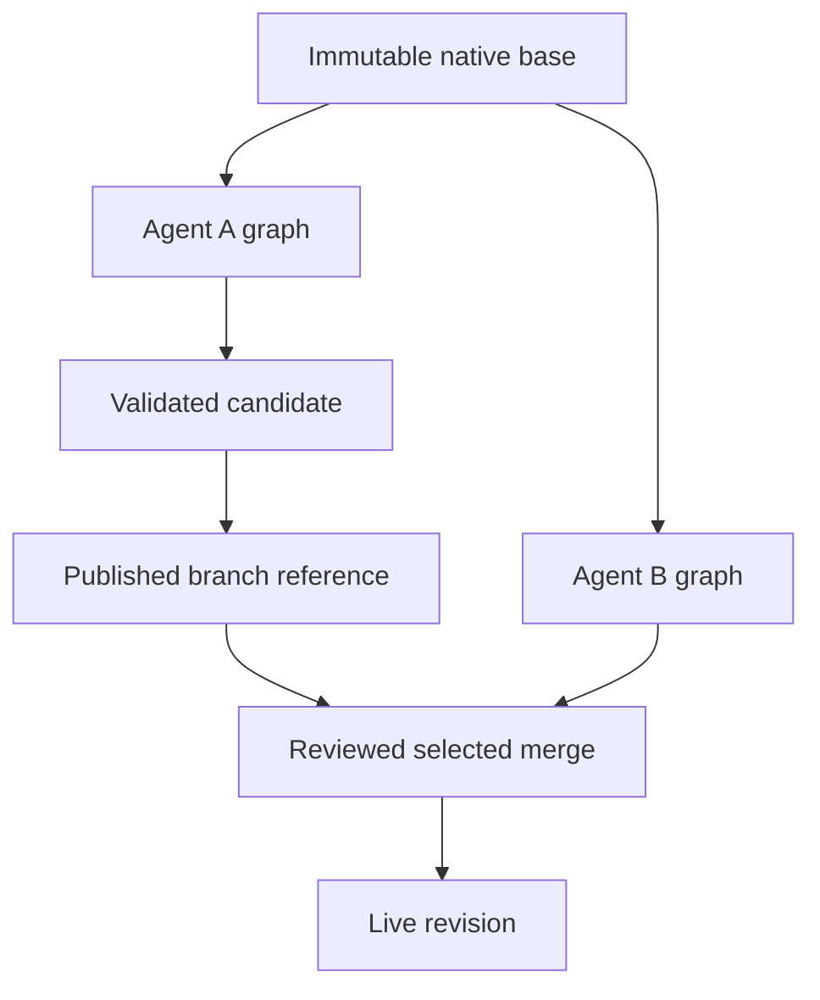

# Letting agents disagree without overwriting reality

Engineering draft, based on the implementation and tests in this repository. The GPU data is synthetic. These are single-writer concurrency controls, not a distributed transaction system.

A launch planner needs to ask two different questions. What was true when this recommendation was made? What would happen if an agent changed the supplier lead time? The first needs stable historical reads. The second needs an isolated working branch and a deliberate way to bring selected changes back.

We implemented those as separate mechanisms. Historical state uses native object and edge versions in the main FalkorDB graph. Editable scenarios use independent native graphs. This gives us a working isolation model, and it makes the remaining cost visible: native graph copying is much more expensive than adding a branch pointer.

## A revision names a state

A coordinated mutation increments an ontology revision. The same Cypher statement updates current objects/edges, closes previous version intervals, appends new versions, writes the commit record and publishes any related checkpoint/history changes. A failed statement cannot acknowledge a revision without its state changes. The API serializes mutation planning through one process-local queue; a second API writer or a direct database mutation would bypass that assumption.

An object version is visible at revision `r` when:

```cypher
v.generation = $generation
AND v.valid_from <= $r
AND (v.valid_to IS NULL OR v.valid_to > $r)
```

Relationship versions carry the same interval fields, between stable identity anchors. Historical traversal filters every edge and the visible endpoint versions. Keeping old vertices alone would not be enough: a current edge could otherwise connect a historical object to something that did not exist at that revision.

The current graph remains a fast view for ordinary CRUD. Historical queries filter native versions in Cypher rather than replaying a JSON audit log in TypeScript. Restoring a logical backup starts a new generation and baseline. We intentionally do not claim that the current logical backup preserves all temporal history.

## Several reads need one pin

An agent may read the graph and then run a calculation. Two independently resolved “latest” calls could observe different revisions. The SDK can acquire a short-lived, principal-owned read snapshot and pass it to both calls. A snapshot fixes an ontology, generation and revision; it is not a mutable transaction.

The GPU history view uses that contract for the displayed graph and recalculated plan. Its historical controls are read-only. Saved calculation evidence contains the actual read records, edges, rules and source values captured with the run. Asking “why?” after a later edit can therefore return retained evidence rather than inventing a path through today's state.

A pin expires or can be explicitly released. Expired/pruned history produces an error, not a fallback to current data. A restored generation invalidates an old pin. These details matter more to a user than whether the UI calls its control a time machine.

## A branch owns its working graph

The first branch at a live revision projects an ontology-only immutable base graph. Siblings use `GRAPH.COPY` from that base. An edit validates its effective state, prepares another native graph, applies the change and then publishes the new graph reference with an incremented branch version.

Readers use the published graph. An unreferenced candidate cannot become a half-edited visible branch. Acknowledged old candidates are removed; startup/discard collection removes unreferenced keys in the managed namespace. Failure tests cover a failed candidate and an acknowledgment lost after publication. A client with an uncertain outcome must reread the branch version before retrying.



Promotion requires the expected branch version, expected live revision, selected records/relationships and explicit confirmation. A three-way comparison uses base, branch and live values. Independent property edits may merge; incompatible changes to the same property conflict. The expected live revision prevents a preview from silently applying after another writer changes live state.

This is optimistic concurrency with a selected property-level merge. It is not first-committer-wins for arbitrary read sets, and it does not prove arbitrary cross-record business invariants. An application that makes a decision across several records must revalidate its relevant dependencies before committing. Supplying no expected revision on an ordinary patch permits last-write behavior.

## What we checked

The [concurrent-history workload](concurrency-checker.md) races guarded increments, atomic pair writes, current reads, pinned reads and branch promotion. Its journal records invocation and completion times. The checker rejects a current read older than a completed write, inconsistent contents at one revision, skewed object pairs, dangling edges, a moving pin and a final counter that differs from the number of successful increments.

The checker itself is tested with deliberately broken histories. Real FalkorDB integration runs exercise two seeds. Other tests check native version boundaries, restore generations, overlapping branch edits, selected merge conflicts, candidate publication failures and bounded retention. Milestone CI also stops and restarts both the API and persistent database and verifies a native branch.

These are useful falsifiable checks. They are not exhaustive schedule exploration, partition testing, a full Jepsen test or evidence for multiple API writers.

## Retention is part of the read contract

For a requested retention boundary, vacuum lowers its watermark to the oldest active read pin. If a version began at revision 2 and ends at revision 9, a watermark of 7 must keep it. Removing every version whose start precedes 7 would corrupt the snapshot. Only closed intervals ending at or before the watermark are eligible, along with inaccessible old generations; the current open versions survive.

The operator previews eligible versions, edge versions, commits and protected pins. Apply requires an explicit confirmation and a digest of the reviewed plan. A changed pin, live revision or prior batch invalidates that digest. Each bounded batch advances the retained boundary and records an audit entry atomically with its removals. Another preview is required before continuing.

Current copy-based branches have independent base graphs and do not depend on temporal versions. A future native overlay branch would need to protect its base revision for its entire lifetime, including generation/restore handling. We have not shipped that alternative. Reclaiming unreferenced identity anchors and exporting full temporal backups also remain separate work.

## The cost we have not hidden

Our [performance study](performance-study.md) records first versus sibling creation and one-record edits. `GRAPH.COPY` makes an independent graph; it is not a persistent-tree pointer or zero-copy snapshot. A small edit therefore still incurs full candidate copy, effective-state validation and pointer publication. Current functions/diffs also materialize full graphs.

The next storage experiment should compare this working default with the former portable JSON representation and a native base-revision-plus-overlay design. It must measure creation, edit, read/projection, promotion, cleanup and retained storage at equal semantics. Cheap branch creation alone would be misleading if every algorithm call then materializes the entire base.

That experiment, larger mixed-load trials and a configured live model/source demonstration remain in the [complete TODO](TODO.md). The work already supports historical explanations and isolated alternatives. The next claim needs another measurement, not a stronger adjective.
